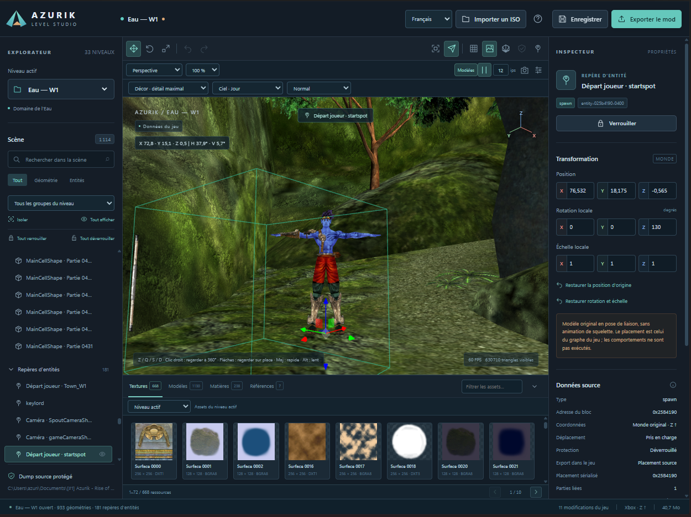
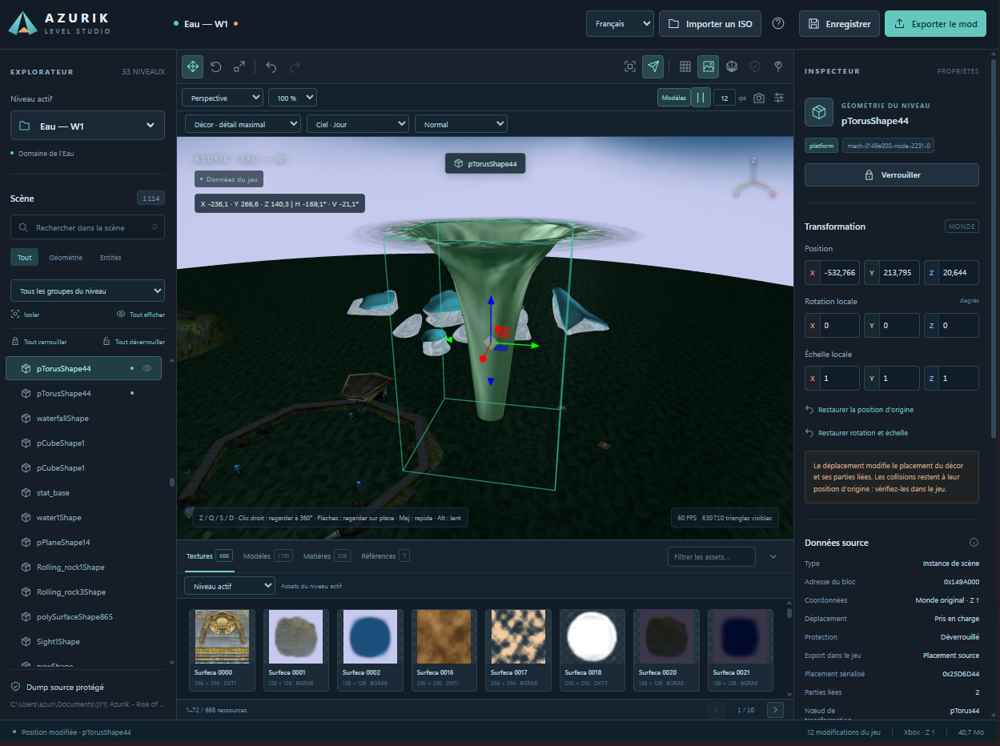
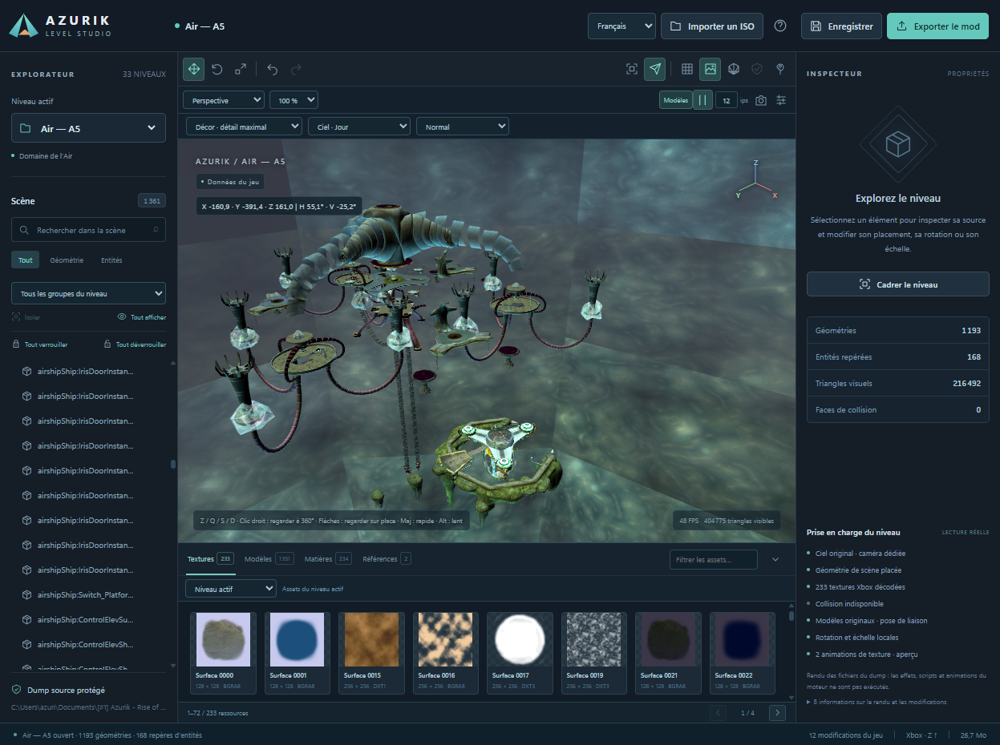
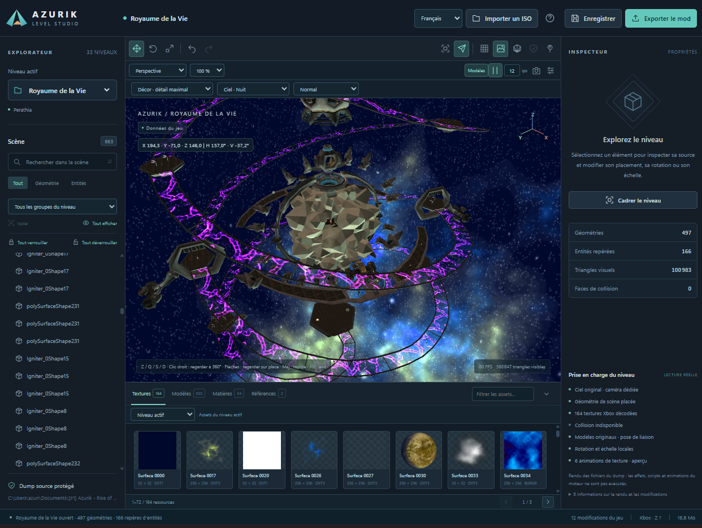

# Screenshots — official release 1.0.0

These four screenshots were supplied by the project owner on 9 October 2026. They show editor views of decoded game data, not a rebuilt disc tested in Xemu. A gameplay comparison can be added when supplied.

## Water W1 — player spawn

Player spawn, character in bind pose, move gizmo, precise inspector and texture browser.

## Water W1 — edited structure

A moved structure with its bounds and placement fields. Collision placement is unchanged.

## Air A5 — level overview

Placed structures and sky/fog preview with original source textures.

## Realm of Life — night sky

Realm layout, night-sky preview and texture browser.

